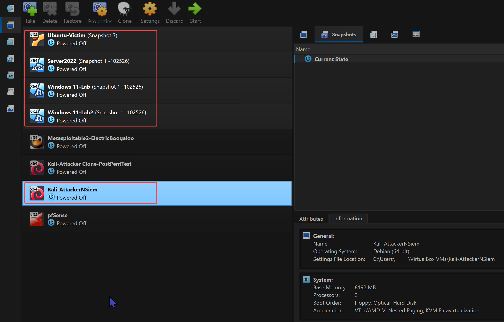
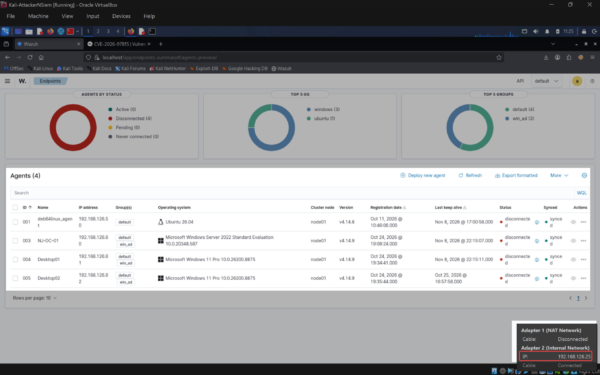
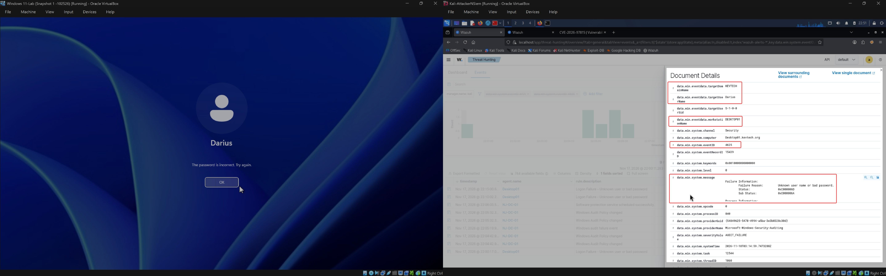

# Consolidated Active Directory & Wazuh SIEM Homelab

## Overview
This repository documents the architecture, deployment, and troubleshooting steps for a 5-VM homelab built in Oracle VirtualBox. Originally maintained as two separate environments (an isolated Linux security sandbox and a Windows Active Directory help desk lab), the infrastructure was consolidated into a unified, segmented network to centralize log collection and validate baseline security events using Wazuh SIEM.

## Network Architecture & Interface Design
To maintain strict lab isolation while allowing controlled access for OS updates and package installations, each virtual machine is configured with dual network adapters in Oracle VirtualBox:
* **Adapter 1 – NAT Network:** Kept disconnected during normal lab operations and enabled strictly for outbound OS updates and package installations without exposing VMs to the host LAN.
* **Adapter 2 – Internal Network (`intnet` – `192.168.126.0/24`):** Dedicated, isolated host-to-host network used for all Active Directory authentication, GPO deployments, and Wazuh SIEM telemetry.

### Static IP Addressing (`192.168.126.0/24` – `intnet`)

| Hostname / Agent Name | Operating System | Internal IP (`intnet`) | Wazuh Group | Role & Services |
| :--- | :--- | :--- | :--- | :--- |
| **`Kali-AttackerNSiem`** | Kali Linux | `192.168.126.25` | — | Wazuh SIEM Manager & Dashboard |
| **`deb64linux_agent`** | Ubuntu 26.04 | `192.168.126.50` | `default` | Monitored Linux Endpoint (Wazuh Agent, Action1) |
| **`NJ-DC-01`** | Windows Server 2022 | `192.168.126.60` | `default`, `win_ad` | Domain Controller (AD DS, DNS, GPO, File Share) |
| **`Desktop01`** | Windows 11 Pro | `192.168.126.61` | `default`, `win_ad` | Domain-Joined Workstation (Wazuh Agent, Action1) |
| **`Desktop02`** | Windows 11 Pro | `192.168.126.62` | `default`, `win_ad` | Domain-Joined Workstation (Wazuh Agent, Action1) |

*Figure 1: Oracle VirtualBox lab inventory highlighting the active 5-VM Wazuh SIEM & Active Directory environment (spotlighted), alongside staged VMs (`Kali-Attacker Clone-PostPentTest` and `pfSense`) queued for future roadmap phases.*

*Figure 2: Wazuh Endpoints dashboard displaying all four registered Windows and Linux agents (`192.168.126.50`–`.62`) and custom `win_ad` grouping, alongside VirtualBox network adapter status confirming `NAT` is disconnected while `intnet` (`192.168.126.25`) remains isolated.*

## Key Implementations
1. **Active Directory & GPO Software Deployment:** Structured Active Directory Organizational Units (OUs) for domain controllers and workstations, created a custom `win_ad` agent group, customized the Wazuh `.msi` installer using Orca, hosted it on a network file share, and deployed agents across Windows endpoints via Group Policy (`gpupdate /force`).
2. **Subnet Migration & Troubleshooting:** Migrated all VMs from a `10.x.x.x` private range to `192.168.126.0/24` and resolved domain-trust credential failures during UAC elevation prompts via local administrator remediation.
3. **Log Ingestion & Event Verification:** Verified end-to-end telemetry by generating baseline security events (such as failed authentication attempts) and confirming agent registration and log visibility in the Wazuh dashboard.

*Figure 3: Live end-to-end telemetry verification showing a simulated domain authentication failure for sample user `Darius` on `Desktop01` (`192.168.126.61`) alongside the corresponding Windows Event ID `4625` alert ingested on `Kali-AttackerNSiem` (`192.168.126.25`).*
   
4. **Patch & Ticket Workflows:** Utilized Action1 for endpoint patch management and vulnerability remediation alongside Jira for end-user ticket workflow simulations.
5. **Tier-0 GPO Hardening & Automated Vulnerability Remediation:** Deployed the Action1 RMM agent via Group Policy, mitigated a Tier-0 Domain Controller exposure risk by unlinking the GPO from `Domain Controllers` and migrating it to the `Workstations` OU, and automated critical patching down to zero vulnerabilities.
6. **Adversary Emulation & Wazuh Alert Correlation:** Conducted Nmap reconnaissance, SSH remote access, local user lifecycle tampering (`useradd`/`passwd`/`userdel`), and multi-user Hydra SSH brute-forcing from `Kali-AttackerNSiem` against `deb64linux_agent`, validating MITRE ATT&CK detections (`rule.id` `5710`, `5760`, `5763`, `40112`, `5902`–`5903`).

## Repository Documentation
* [Troubleshooting: RFC-1918 Subnet Migration & UAC Domain-Trust Error](./troubleshooting/subnet-migration-uac-fix.md)
* [Deployment Guide: Wazuh Agent Rollout via Active Directory GPO & Orca](./deployment-guides/wazuh-gpo-deployment.md)
* [Deployment Guide: Action1 Linux Agent Rollout & Wazuh Telemetry Verification](./deployment-guides/action1-ubuntu-agent-deployment.md)
* [Deployment Guide: Action1 Windows Agent Rollout via GPO, Tier-0 Hardening & Patch Remediation](./deployment-guides/action1-gpo-deployment-and-remediation.md)
* [Threat Hunting: SSH Brute-Force & Local Account Tampering](./threat-hunting/ssh-brute-force-and-account-tampering.md)

## Future Lab Roadmap (Planned Enhancements)
To expand this environment from centralized SIEM monitoring into a full Security Operations & Incident Response (SOAR/DFIR) lab within a 16GB host RAM budget, the following upgrades are planned:

* **Consolidated Defensive Management Node:** Co-locate **Shuffle** (SOAR), **DFIR-IRIS** (Incident Response case management), and **Velociraptor** (endpoint triage/forensics) alongside the existing **Wazuh Manager** on `Kali-AttackerNSiem` to minimize hypervisor RAM overhead during multi-VM scenarios.
* **Standalone Attacker VM Restoration:** Restore `Kali-Attacker Clone-PostPentTest` with a dedicated static IP and hostname as an isolated **Attacker VM** for controlled adversary emulation separated from the defensive stack.
* **Network Segmentation & Firewalling (`pfSense`):** Configure the staged `pfSense` firewall VM to manage subnet routing, enforce firewall rules, and forward network telemetry into Wazuh.
* **Automated Detection & Triage Workflows:** Connect Wazuh alerts to Shuffle webhooks to automatically create DFIR-IRIS cases and trigger Velociraptor artifact collections upon simulated suspicious activity.
