# Action1 RMM Deployment via Group Policy & Patch Remediation

This guide covers deploying the **Action1 RMM** agent across Windows endpoints using Active Directory Group Policy, remediating an initial Tier-0 Domain Controller exposure risk by migrating the GPO to the `Workstations` OU, verifying endpoint telemetry in **Wazuh SIEM**, and executing automated vulnerability remediation.

---

## Prerequisites & Network Topology

* **Domain Controller (`NJ-DC-01.kevtech.org`):** `192.168.126.60` (Windows Server 2022)
* **Workstation 1 (`Desktop01.kevtech.org`):** `192.168.126.61` (Windows 11 25H2 — User: `KEVTECH\Darius`)
* **Workstation 2 (`Desktop02.kevtech.org`):** `192.168.126.62` (Windows 11 25H2 — User: `KEVTECH\Yeji`)
* **Wazuh SIEM Manager (`kali`):** `192.168.126.25`
* **Network Requirement:** Both Windows 11 endpoints require outbound internet access (configured with a secondary NAT adapter in VirtualBox) to communicate with the Action1 cloud console (`://action1.com`).

---

## Phase 1: Stage the Action1 MSI Installer

1. Log into the Action1 console on `NJ-DC-01` and download the Windows `.msi` agent installer.
2. Move the `.msi` package from `Downloads` into the domain network share (`\\NJ-DC-01\dc`) so domain-joined machines can access it during startup policy processing.

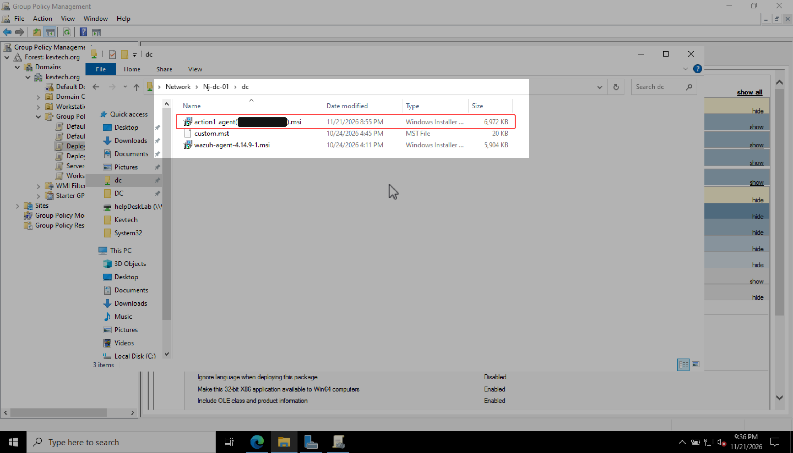

---

## Phase 2: Create the Software Installation GPO & Tier-0 Risk Remediation

### 2.1 Initial GPO Creation & Package Assignment

1. Open **Group Policy Management** on `NJ-DC-01`.
2. Right-click the target Organizational Unit, select **Create a GPO in this domain, and Link it here...**, name it `Deploy-Action1-Servers`, and click **OK**.

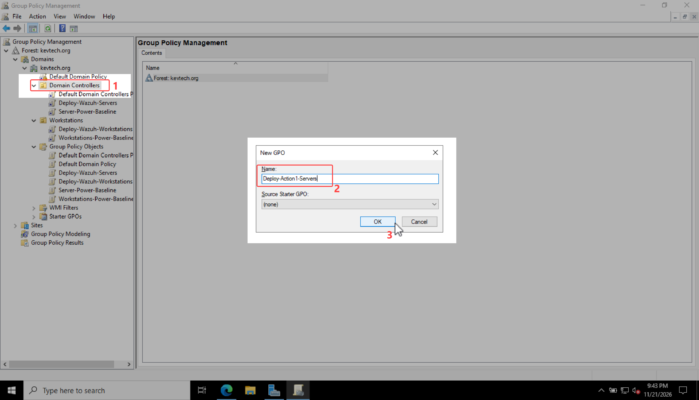

3. Right-click the newly created GPO and select **Edit...** to open the **Group Policy Management Editor**.

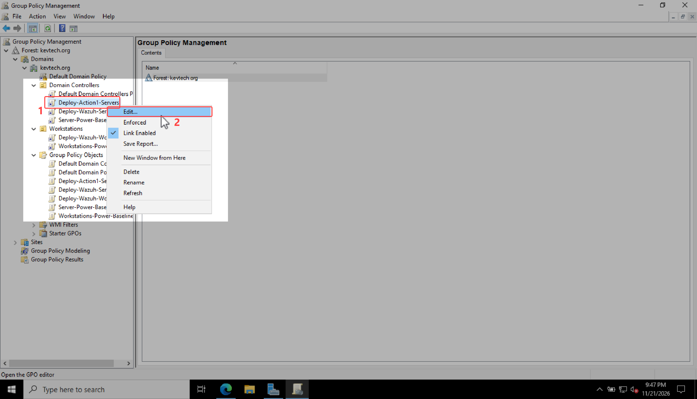

4. Collapse **User Configuration** so focus remains on **Computer Configuration**. Navigate to:
   `Computer Configuration > Policies > Software Settings > Software installation`
5. Right-click the empty right-hand pane and select **New > Package...**.

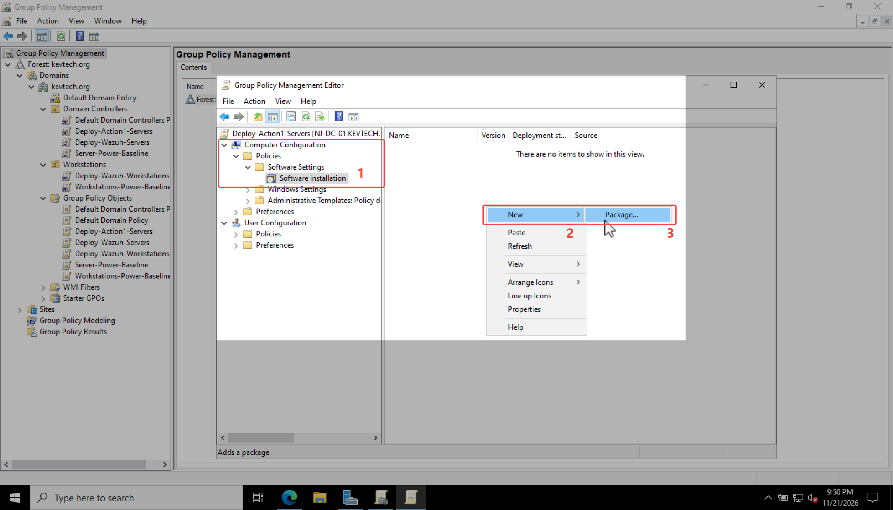

6. Browse to the network share via its UNC path (`\\NJ-DC-01\dc\`), select the Action1 `.msi` installer, and click **Open**.

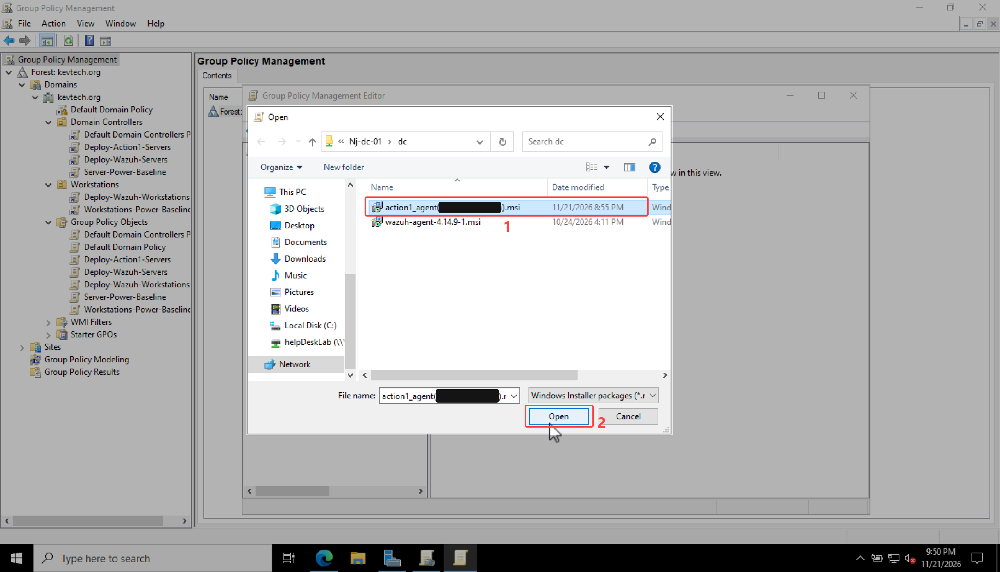

7. In the **Deploy Software** prompt, keep the default **Assigned** deployment method and click **OK**.

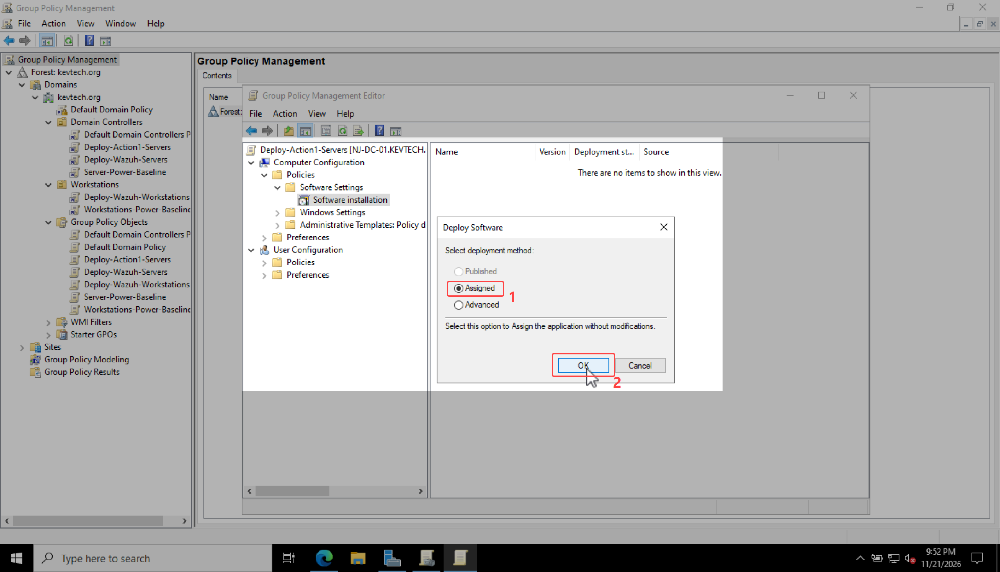

8. Confirm that **Action1 Agent** populates in the Software Installation pane with the full UNC source path.

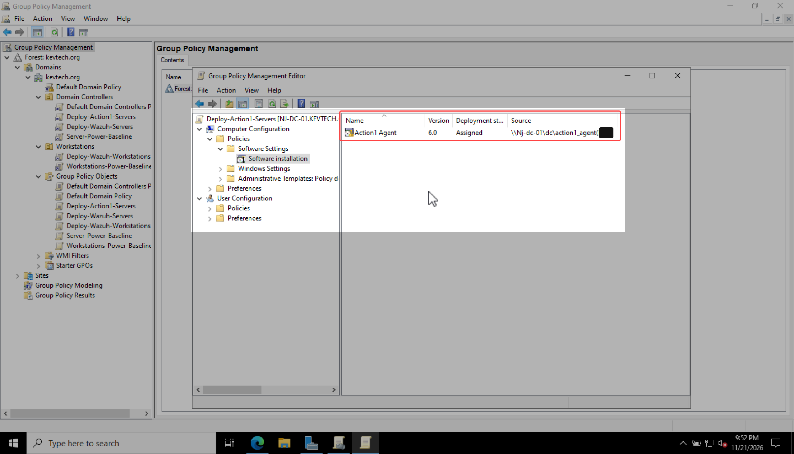

---

### 2.2 Security Hardening: Unlinking from Domain Controllers & Relinking to Workstations

During initial creation, the GPO was linked to the **Domain Controllers** OU, which triggered Windows Installer activity on `NJ-DC-01` (captured in Wazuh under `EventID 1040` / `rule.id 60610`).

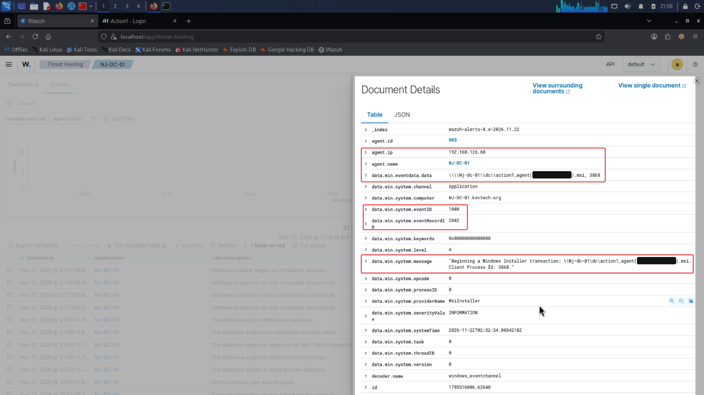

**Security Rationale:** Domain Controllers are **Tier-0 assets**. Deploying third-party RMM agents onto a Domain Controller unnecessarily expands the Tier-0 attack surface. To isolate management scope strictly to end-user endpoints:

1. Under the **Domain Controllers** OU, right-click `Deploy-Action1-Servers`, click **Delete** (which unlinks the GPO without deleting the underlying GPO object), and confirm **OK**.

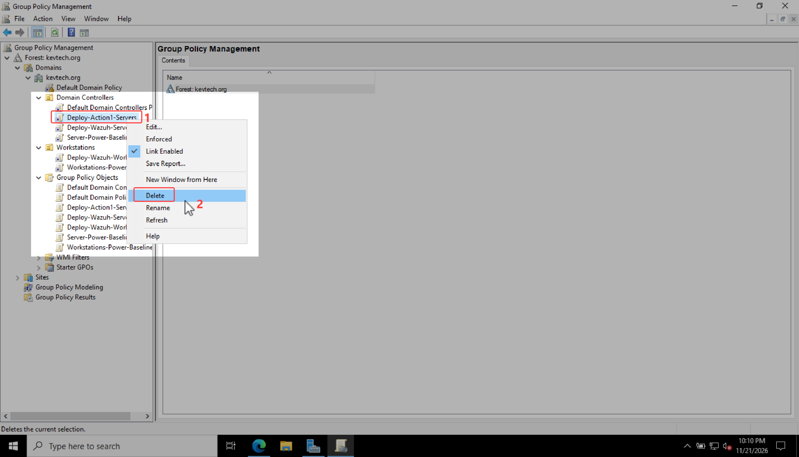

2. Navigate to **Group Policy Objects** in the left tree and rename the GPO from `Deploy-Action1-Servers` to `Deploy-Action1-Workstations`.
3. Right-click the **Workstations** OU, select **Link an Existing GPO...**, choose `Deploy-Action1-Workstations`, and click **OK**.

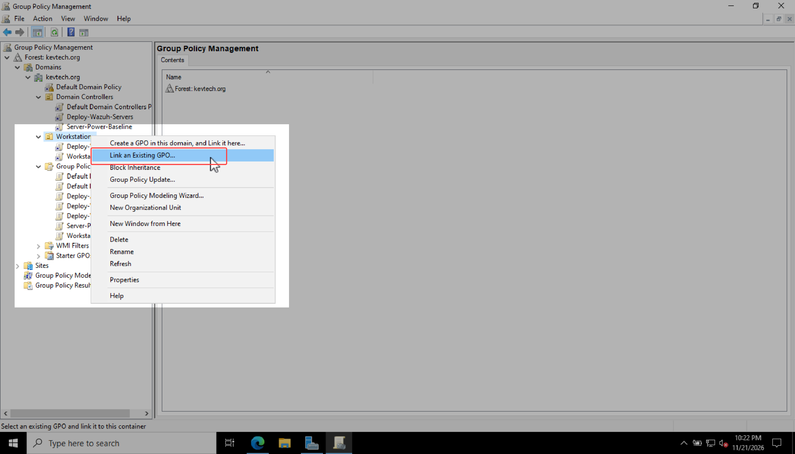

---

## Phase 3: Force Group Policy Update on Endpoints & Verify Telemetry

Because Computer Configuration software installation policies apply at system startup, force a policy refresh and reboot on both `Desktop01` and `Desktop02`:

1. Log into each Windows 11 endpoint (`Desktop01` and `Desktop02`).
2. Open **Command Prompt** as **Administrator** and run:
   ```cmd
   gpupdate /force
   ```
3. When prompted `OK to restart? (Y/N)`, type `y` and press **Enter** to reboot and install the `.msi` package.

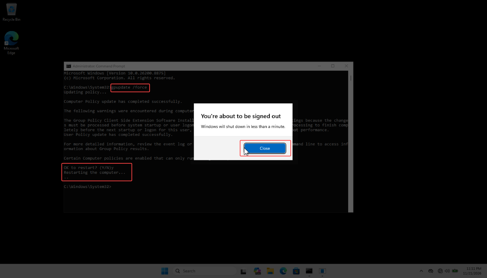

### Wazuh SIEM & Action1 Verification

* **Wazuh Telemetry:** Upon reboot, Wazuh captures Service Control Manager `EventID 7045` (`rule.id 61138`, MITRE `T1543.003` — *Windows Service*) confirming `Action1 Agent` (`C:\WINDOWS\Action1\action1_agent.exe`) was installed under `LocalSystem` on both `Desktop01` (`192.168.126.61`) and `Desktop02` (`192.168.126.62`).

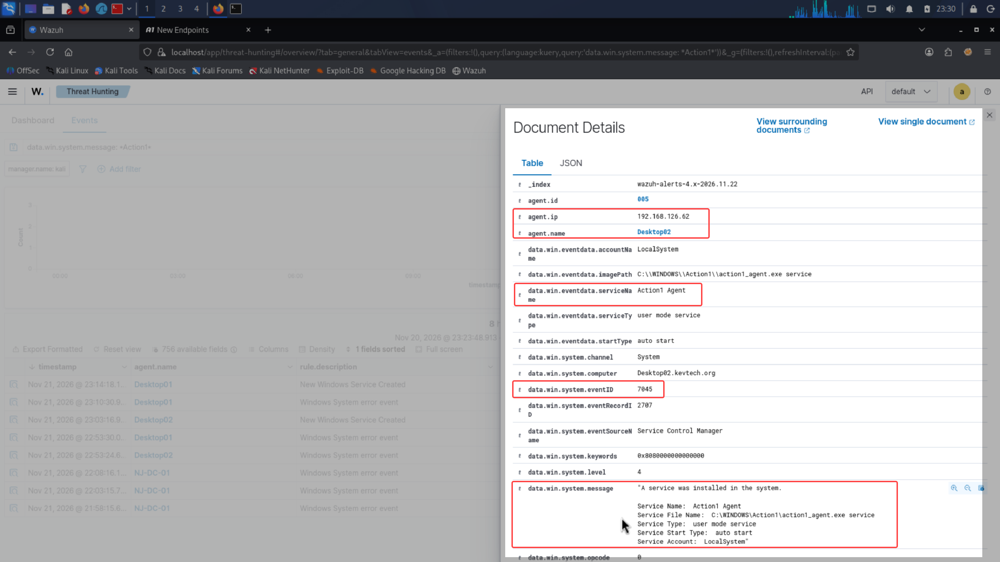

* **Action1 Console:** Both `Desktop01.kevtech.org` and `Desktop02.kevtech.org` appear as **Connected** under **New Endpoints**, reporting initial vulnerability and missing update baselines (`22 critical` vulnerabilities per host).

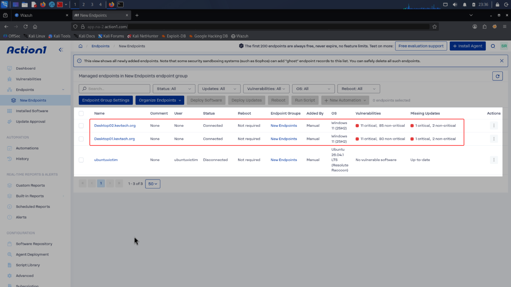

---

## Phase 4: Vulnerability Remediation & Automated Patching

1. **Targeted Vulnerability Remediation (Microsoft Edge):**
   * Select `Desktop01.kevtech.org`, open the **Vulnerabilities** tab, filter for `edge`, and click **Start Remediation**.
   * Select the vulnerable Microsoft Edge CVEs (e.g., `CVE-2026-84325`, `CVE-2026-19149`) to deploy update `158.0.4370.33`, target `Desktop01.kevtech.org`, and schedule **Run now**.

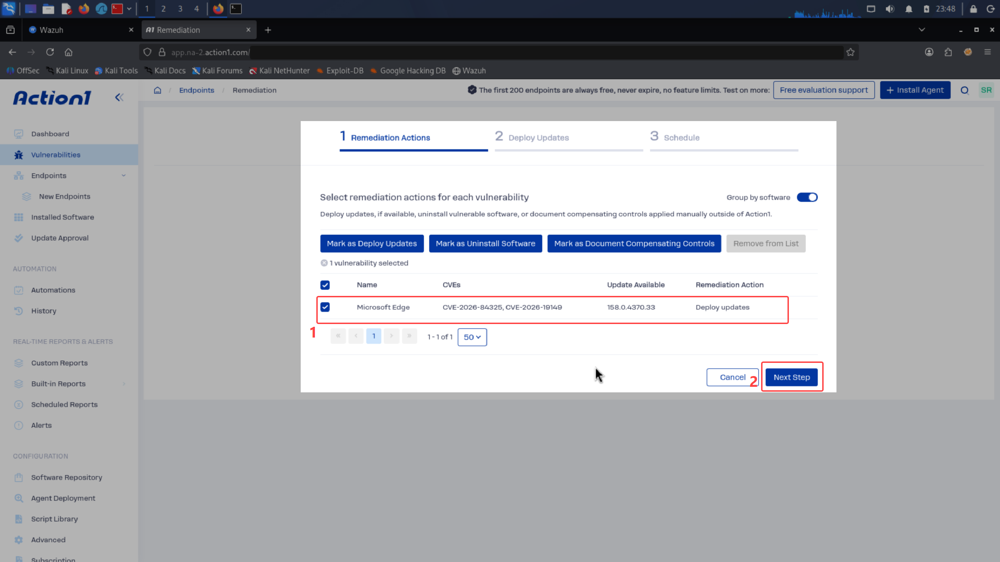

2. **Automated Critical Patch Deployment:**
   * Navigate to **Deploy Updates**, set **Matching filters** to `Update severities include Critical`, enable automatic reboot with a user countdown warning, and check **Deactivate updates in Windows settings** so Action1 exclusively manages patch windows.

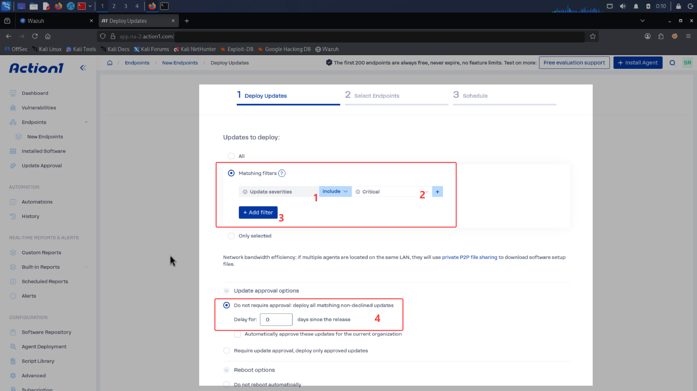

3. **SIEM & Compliance Verification:**
   * Wazuh logs `MsiInstaller` `EventID 11707` (`rule.id 60612`) confirming `"Product: Microsoft Edge -- Installation completed successfully."` on `Desktop01`.

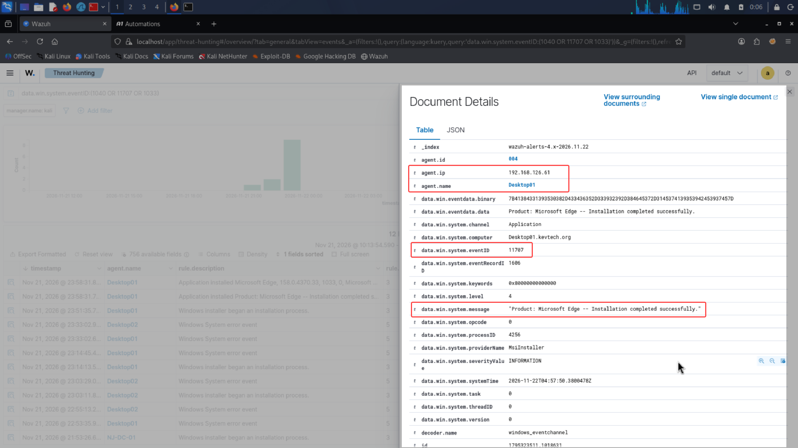

   * After completing critical security intelligence, .NET, cumulative OS, and application updates across `Desktop01` and `Desktop02`, the Action1 Dashboard reflects **0 Vulnerabilities**, **0 Missing updates**, and **100% SLA compliance**.

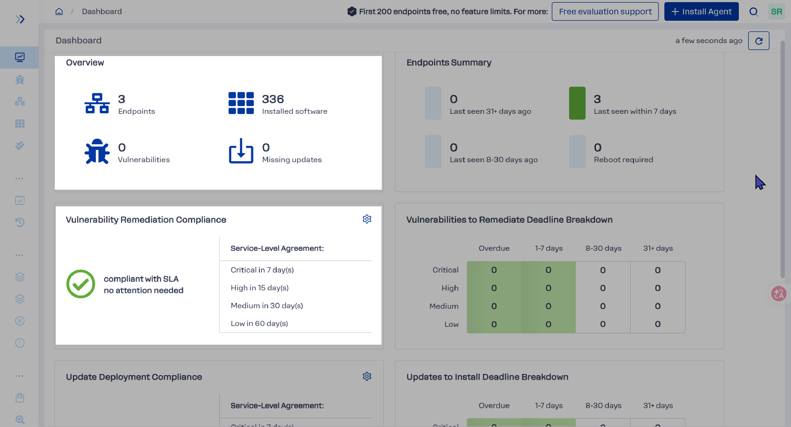
