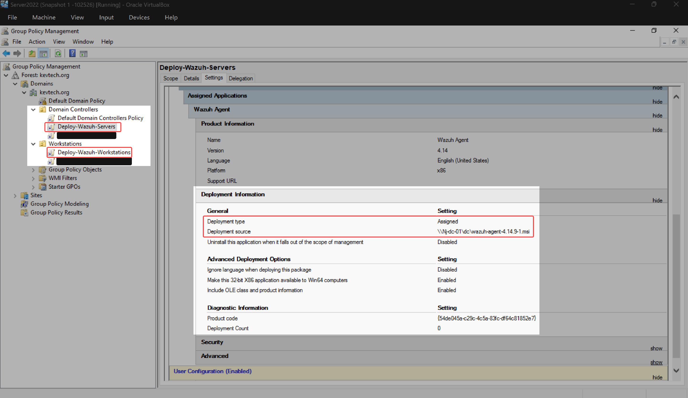

# Deployment Guide: Wazuh Agent Rollout via Active Directory GPO & Orca

## Overview
To deploy Wazuh agents consistently across domain-joined Windows endpoints (`NJ-DC-01`, `Desktop01`, and `Desktop02`) without manual per-host installation, the official Wazuh Windows `.msi` installer (`v4.14.9`) was configured using **Orca** and deployed centrally through **Active Directory Group Policy Objects (GPOs)**.

## Prerequisites
* **Wazuh SIEM Manager:** Operational on `Kali-AttackerNSiem` (`192.168.126.25`) with agent enrollment authentication enabled (`/var/ossec/etc/ossec.conf` and `authd.pass`) and a custom `win_ad` agent group configured.
* **Domain Controller:** Windows Server 2022 (`NJ-DC-01` – `192.168.126.60`, domain `kevtech.org`) running Active Directory Domain Services (AD DS) and Group Policy Management.
* **Installer Tools:** Official Wazuh Windows `.msi` installer (`wazuh-agent-4.14.9-1.msi`) and **Orca** (Windows SDK MSI database editor).

## Deployment Steps

### 1. Configure Wazuh Manager Enrollment (`Kali-AttackerNSiem`)
1. Enabled password-based agent enrollment in `/var/ossec/etc/ossec.conf` (`<use_password>yes</use_password>`).
2. Configured the enrollment password in `/var/ossec/etc/authd.pass` with restricted ownership (`root:wazuh`, permissions `640`) and restarted `wazuh-manager`.

### 2. Stage the Network File Share (`NJ-DC-01`)
1. Created a dedicated folder (`dc`) on `NJ-DC-01` to host deployment packages over SMB (`\\Nj-dc-01\dc\`).
2. Configured SMB sharing and NTFS permissions with **Read** access granted to **Authenticated Users** so domain endpoints can access the installer across the isolated `192.168.126.0/24` internal network.

### 3. Customize Installer Properties with Orca
1. Opened `wazuh-agent-4.14.9-1.msi` in **Orca** and navigated to the **Property** table.
2. Configured the required deployment variables (including manager IP `192.168.126.25`, `PROTOCOL` = `TCP`, enrollment `PASSWORD`, and `WAZUH_AGENT_GROUP` = `win_ad`) and saved the customized installer/transform package into `\\Nj-dc-01\dc\`.

### 4. Configure Active Directory OUs & Group Policy (`gpmc.msc`)
1. Organized computer accounts in **Active Directory Users and Computers (`dsa.msc`)** into dedicated Organizational Units (**Domain Controllers** and **Workstations**).
2. Created two separate GPOs in **Group Policy Management (`gpmc.msc`)**—**`Deploy-Wazuh-Servers`** and **`Deploy-Wazuh-Workstations`**—and linked them to their respective OUs.
3. Edited each GPO under **Computer Configuration > Policies > Software Settings > Software installation**:
   * Selected **New > Package...** and pointed to the UNC share path (`\\Nj-dc-01\dc\wazuh-agent-4.14.9-1.msi`).
   * Selected **Assigned** as the deployment method.

### 5. Enforce Policy & Verify Agent Registration
1. Forced a Group Policy refresh on each Windows endpoint via Command Prompt:
   ```cmd
   gpupdate /force
   ```
2. Rebooted the Windows VMs so the computer-level software installation policy executed during startup (and verified `WazuhSvc` service activation).
3. Verified agent enrollment on `Kali-AttackerNSiem` using `/var/ossec/bin/agent_control -l` and confirmed `NJ-DC-01` (`192.168.126.60`), `Desktop01` (`192.168.126.61`), and `Desktop02` (`192.168.126.62`) appeared active under the `win_ad` group on the Wazuh dashboard.


*Figure 1: Group Policy Management (`gpmc.msc`) configuration showing `Deploy-Wazuh-Servers` and `Deploy-Wazuh-Workstations` linked to their respective OUs, deploying `\\Nj-dc-01\dc\wazuh-agent-4.14.9-1.msi` as an Assigned computer package.*

## Reference
* Adapted from the official Wazuh engineering guide: [Deploying Wazuh agents using Windows Group Policy Objects (GPO)](https://wazuh.com/blog/deploying-wazuh-agent-using-windows-gpo/)
