# Threat Hunting: SSH Brute-Force & Local Account Tampering

This lab documents an end-to-end attack simulation from a **Kali Linux** attacker VM against a monitored **Ubuntu** endpoint (`deb64linux_agent`), correlating reconnaissance, remote access, local privilege escalation, user account manipulation, and credential brute-forcing with **Wazuh SIEM** alerts and MITRE ATT&CK mappings.

---

## Lab Environment

| Role | Hostname / Agent Name | IP Address | OS / Details |
| :--- | :--- | :--- | :--- |
| **Attacker & SIEM** | `kali` | `192.168.126.25` | Kali Linux (Running Nmap, Hydra, OpenSSH, Wazuh Manager) |
| **Victim Endpoint** | `ubuntuvictim` (`deb64linux_agent`) | `192.168.126.50` | Ubuntu 26.04.1 LTS (Wazuh Agent ID `001`) |

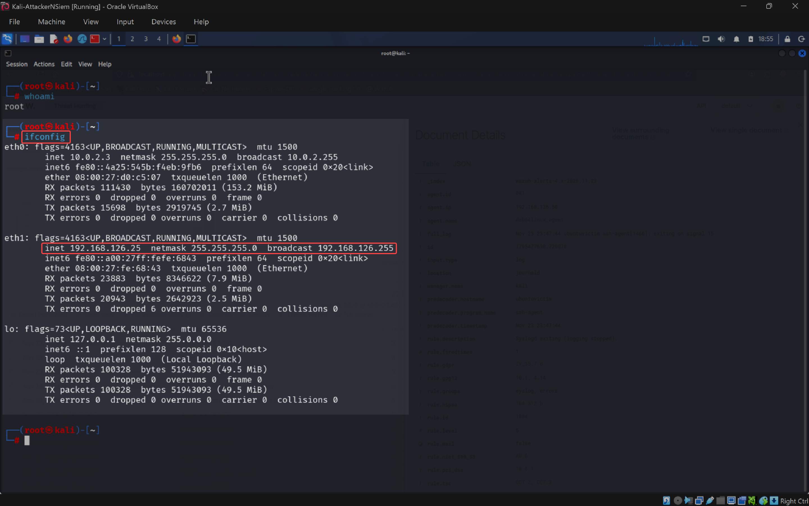

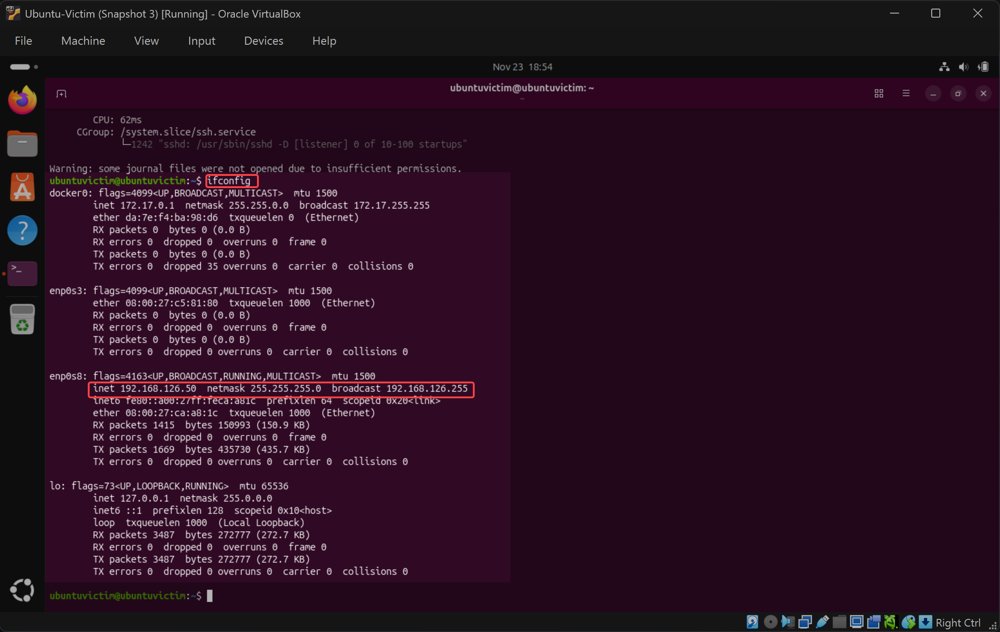

---

## Phase 1: Service Verification & Network Reconnaissance

1. **Target Service State:** Confirm the OpenSSH server daemon (`ssh.service`) is active and listening on `ubuntuvictim` (`systemctl status ssh`).

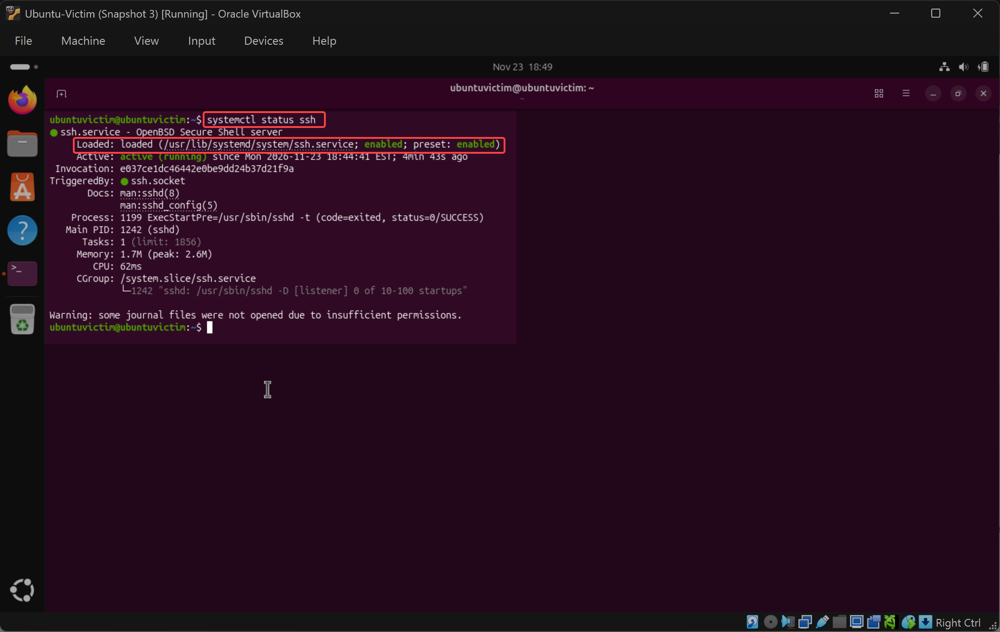

2. **Full-Port Service Enumeration:** From Kali (`192.168.126.25`), run a full-port TCP version scan against `192.168.126.50`:
   ```bash
   nmap 192.168.126.50 -p- -sV -T5
   ```
   The scan identifies two exposed services:
   * `21/tcp` — `ftp` (`vsftpd 3.0.5`)
   * `22/tcp` — `ssh` (`OpenSSH 10.2p1 Ubuntu`)

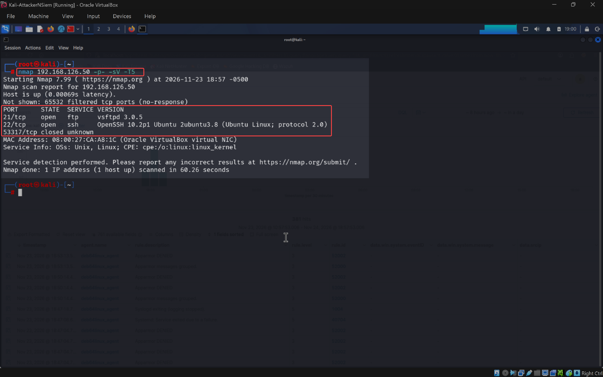

3. **Wazuh Detection:** The Nmap service probe triggers an FTP connection event on the victim host (`rule.id 11401` — *vsftpd: FTP session opened* from `192.168.126.25`).

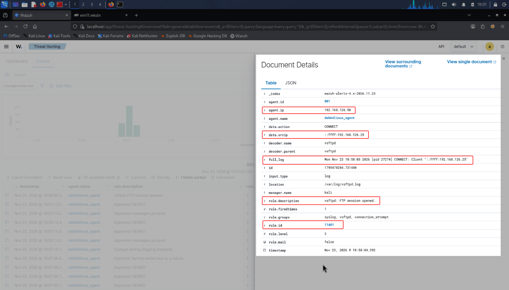

---

## Phase 2: Remote SSH Access & Unauthorized File Creation

1. **SSH Authentication:** Connect from Kali to the victim machine (`ssh ubuntuvictim@192.168.126.50`), navigate to `~/wompwomp`, and write a marker file (`readMeV2.txt`) to simulate post-access tampering.

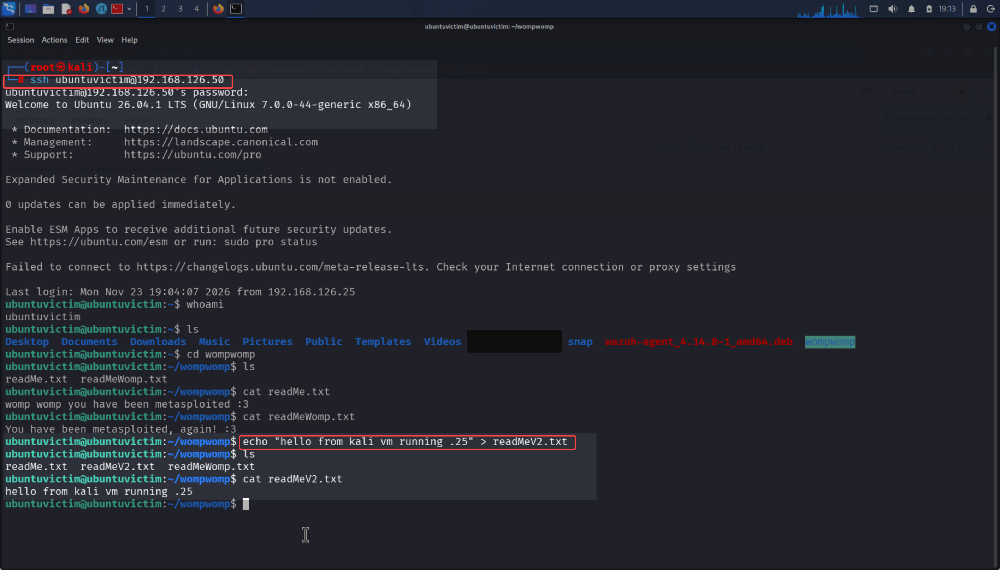

2. **Wazuh Detection:** Wazuh ingests the `sshd-session` journald event (`rule.id 5715` — *sshd: authentication success*), mapping the activity to MITRE **T1078** (*Valid Accounts*) and **T1021** (*Remote Services*).

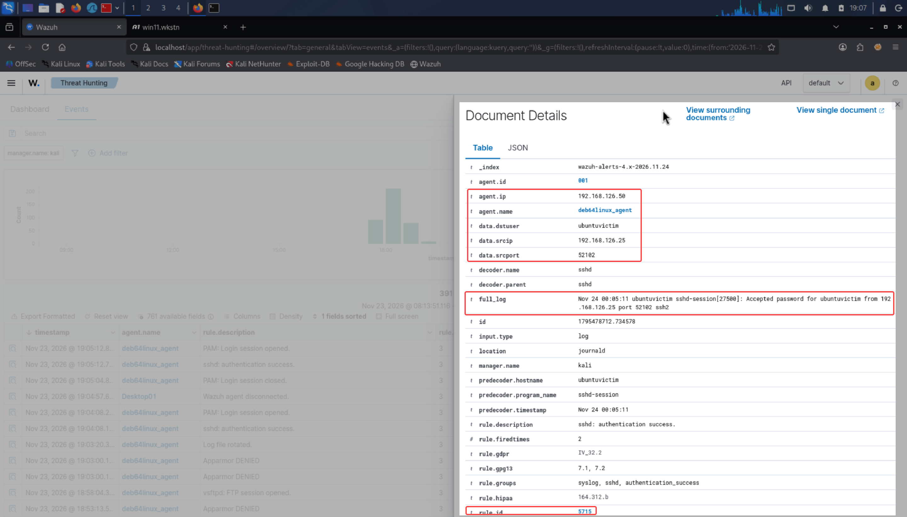

---

## Phase 3: Privilege Escalation & Local Account Lifecycle Tampering

To test Wazuh's Linux account auditing rules, a local account (`ronaldo`) was created, modified, and removed on `ubuntuvictim` via `sudo su`:

1. **Account Creation (`useradd ronaldo`):** Escalate to `root` and create a new local user account.

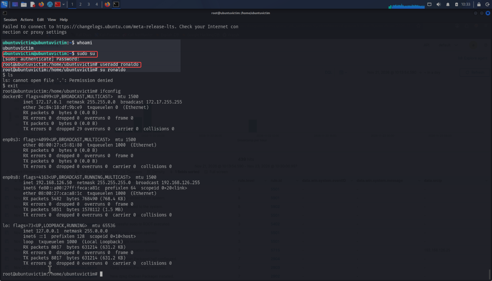

   * **Wazuh Alert (`rule.id 5902` / `5901`):** *New user added to the system* (`UID=1003`, `GID=1003`).

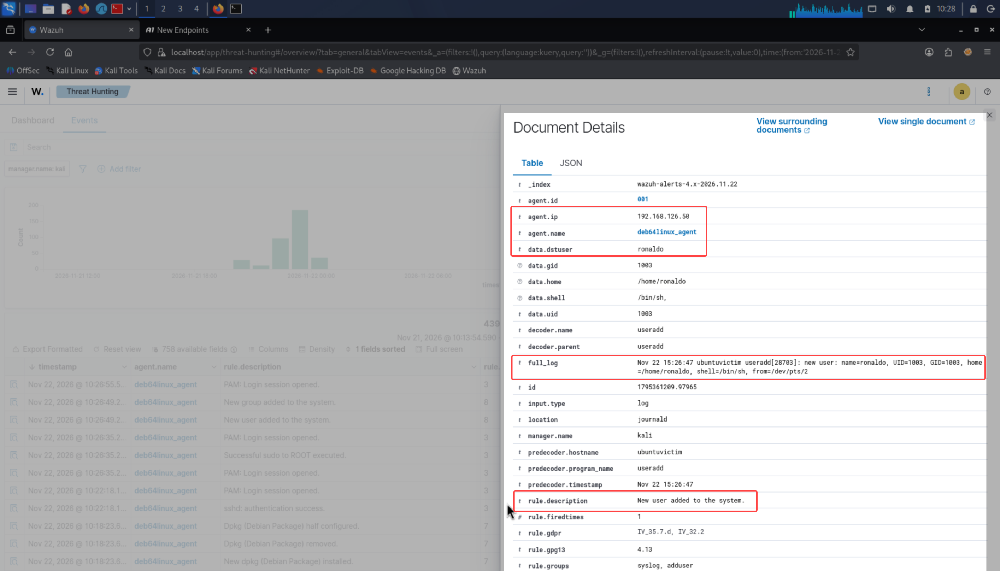

2. **Password Modification (`passwd ronaldo`):** Set/update the password for `ronaldo`.
   * **Wazuh Alert (`rule.id 5555`):** *PAM: User changed password* (`pam_unix(passwd:chauthtok)`).

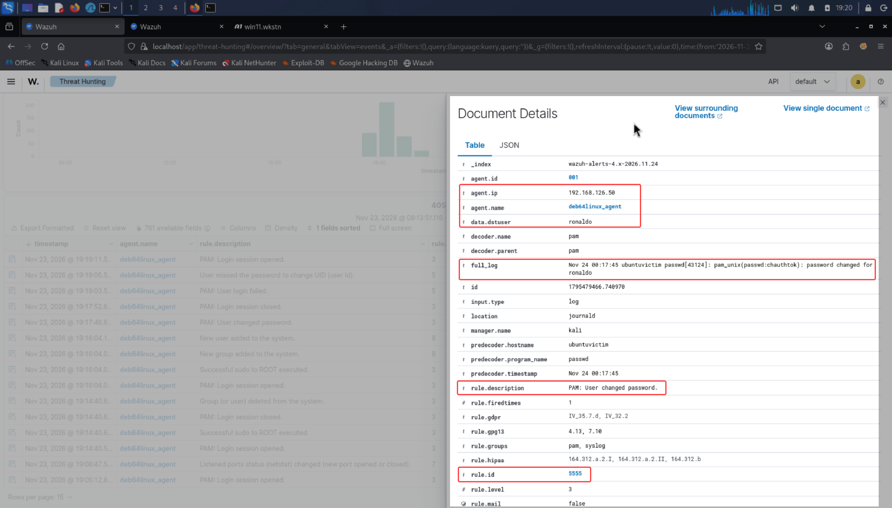

3. **Account Removal (`userdel ronaldo`):** Delete the account during cleanup/testing.
   * **Wazuh Alert (`rule.id 5903`):** *Group (or user) deleted from the system*, mapped to MITRE **T1531** (*Account Access Removal*).

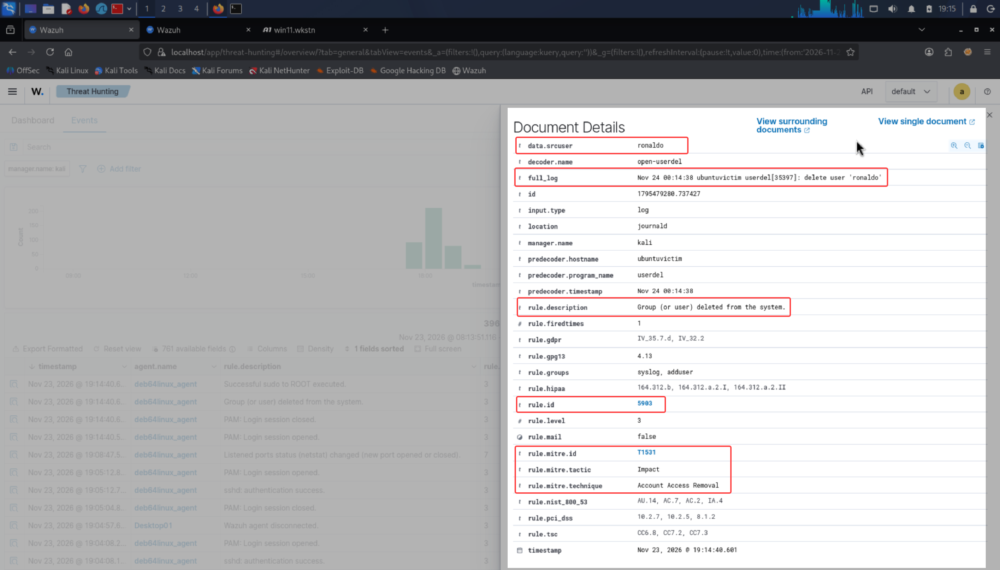

---

## Phase 4: Multi-User SSH Brute-Force Attack with Hydra

1. **Wordlist Preparation:** Create targeted username (`usrs.txt`, 8 entries including `ubuntuvictim` and `ronaldo`) and password (`pass.txt`, 7 entries including `123456`) wordlists on Kali.

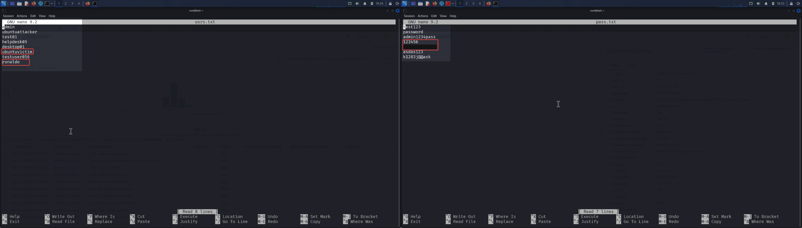

2. **Executing Hydra:** Launch a 2-thread SSH dictionary attack (`56` total login combinations) against `192.168.126.50`:
   ```bash
   hydra -L usrs.txt -P pass.txt 192.168.126.50 ssh -t 2
   ```
   Hydra successfully recovers **two valid credential pairs**: `ubuntuvictim` and `ronaldo:123456`.

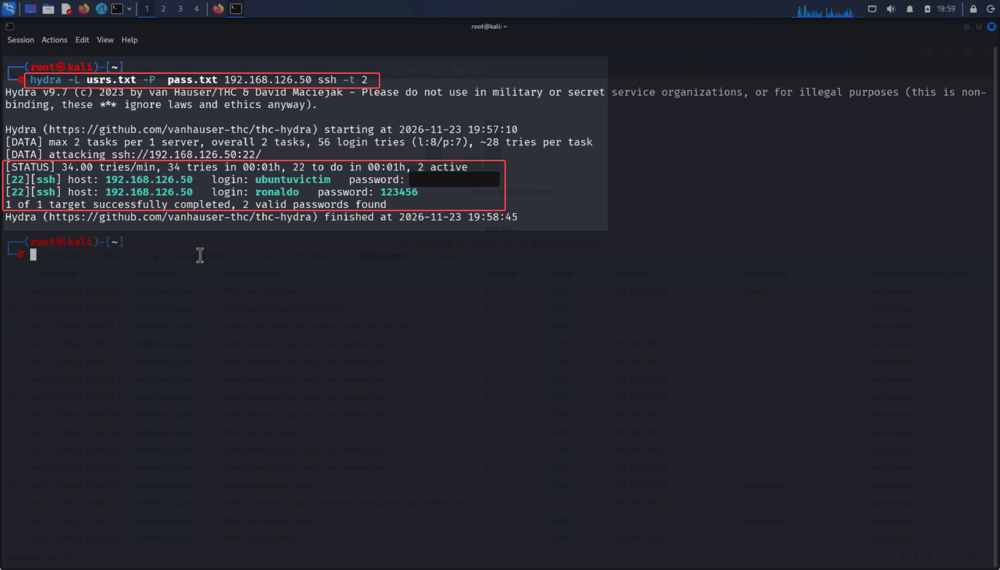

---

## Phase 5: Wazuh SIEM Alert Correlation Summary

In the Wazuh **Threat Hunting** dashboard, the attack sequence generates a clear progression of alerts from source IP `192.168.126.25`:

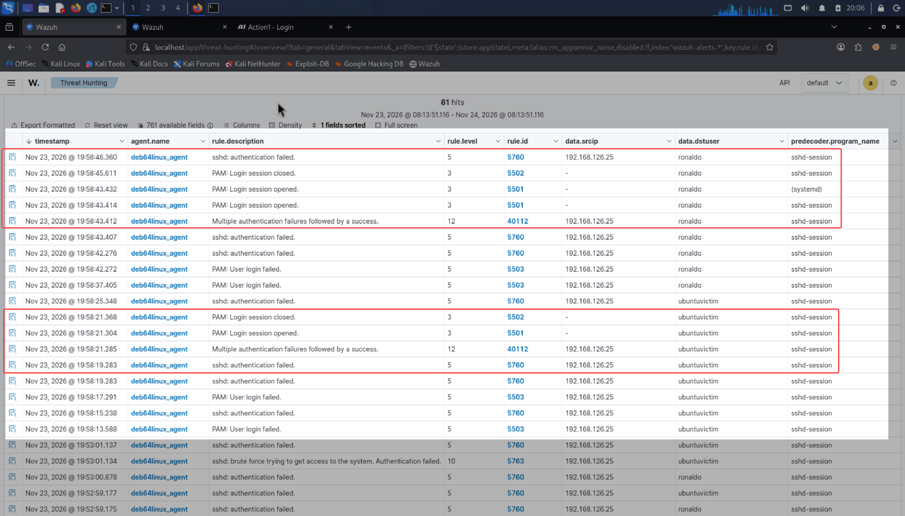

| Rule ID | Level | Description | MITRE ATT&CK | Detection Significance |
| :--- | :---: | :--- | :--- | :--- |
| **`5710`** | `5` | `sshd: Attempt to login using a non-existent user` | `T1110` | Flags invalid usernames from `usrs.txt` (`admin`, `test01`, `ubuntuattacker`, etc.). |
| **`5760`** | `5` | `sshd: authentication failed.` | `T1110.001`, `T1021.004` | Records individual failed password guesses against valid accounts (`ubuntuvictim`, `ronaldo`). |
| **`5763`** | `10` | `sshd: brute force trying to get access to the system.` | `T1110` | High-severity threshold alert triggered by rapid repeated SSH failures from `192.168.126.25`. |
| **`40112`** | `12` | `Multiple authentication failures followed by a success.` | `T1078`, `T1110` | Critical correlation alert confirming Hydra compromised both `ubuntuvictim` and `ronaldo`. |

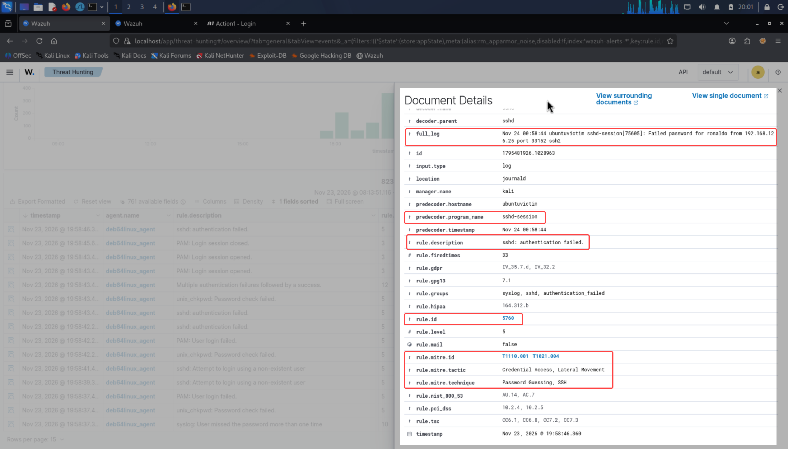

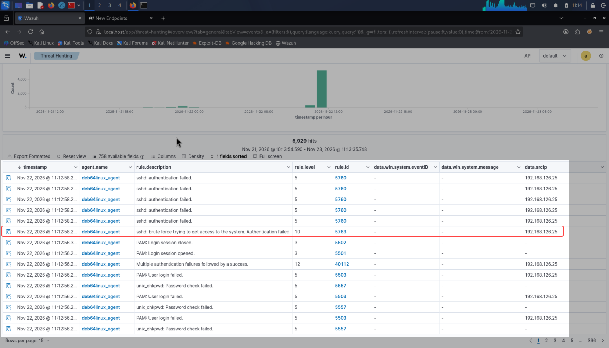

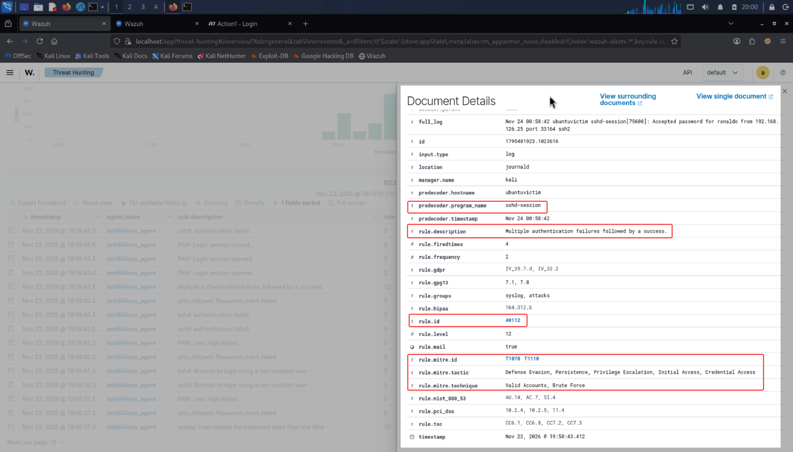
